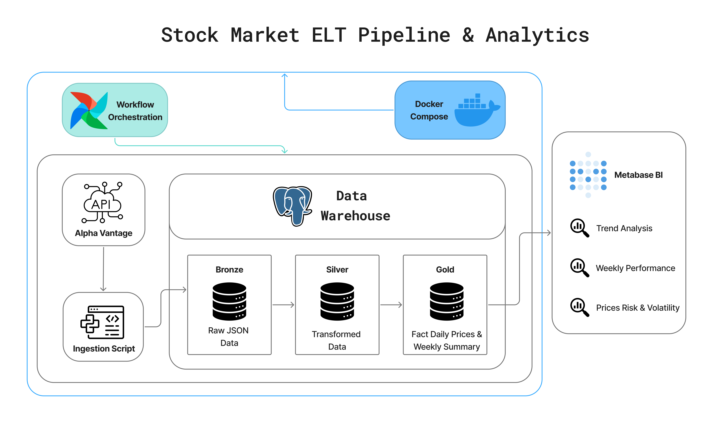
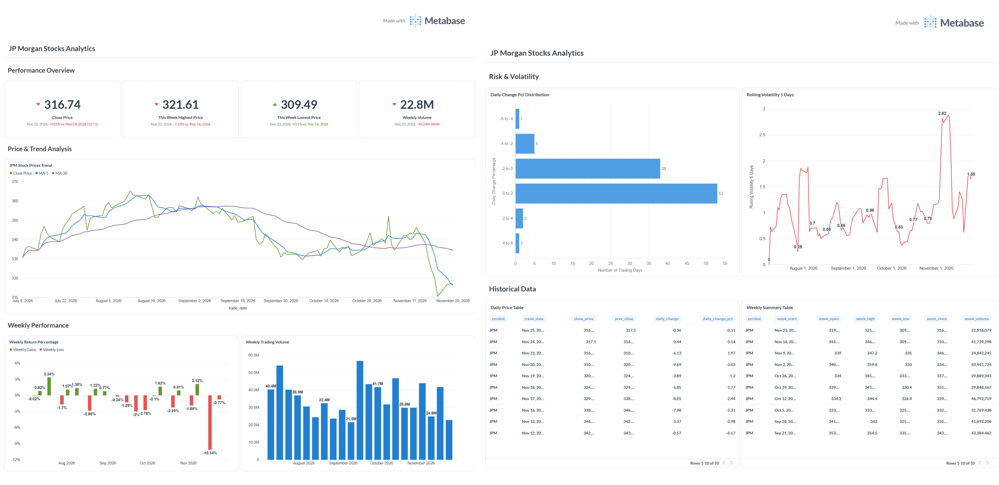

# Stock Market ELT Pipeline & Analytics (Alpha Vantage)

The **JPM Stock ELT Pipeline** is an end-to-end ELT pipeline built to ingest, process, and aggregate historical JPM stock data for performance analysis. Built using Python, PostgreSQL, and Apache Airflow, with Metabase for data visualization.

## Table of Contents

- [Architecture](#architecture)
- [Features](#features)
- [Tech Stack](#tech-stack)
- [Project Installation](#project-installation)
- [Metabase Dashboard](#metabase-dashboard)


## Architecture



## Features

- **Data Ingestion:** Fetches historical JPM stock data from Alpha Vantage API with idempotent UPSERT operations.

- **Medallion Architecture:** Implements Bronze, Silver, and Gold layers with data validation, deduplication, and SQL transformations.

- **Data Modelling:** Builds daily price fact tables and weekly summary data marts for analytical queries.

- **Workflow Orchestration:** Automates daily pipeline execution using Apache Airflow with task dependencies and retry mechanisms.

- **Data Visualization:** Provides interactive Metabase dashboards for stock performance, trading volume, and volatility analysis.

### Tech Stack

- **Python**
- **PostgreSQL**
- **Apache Airflow**
- **Metabase**
- **Docker**

## Project Installation

### 1. Clone Project Repository
```bash
git clone https://github.com/alverogaviota/stock-market-elt-pipeline-and-analytics.git
```

### 2. Move to Cloned Directory
```bash
cd stock-market-elt-pipeline-and-analytics
```

### 3. Configure Environment Variables
* **Linux / macOS / Git Bash / WSL:**
    ```bash
    cp .env.example .env
    ```
* **Windows Command Prompt (cmd):**
    ```bash
    copy .env.example .env
    ```

### 4. Build Docker Compose
```bash
docker compose up -d --build
```

### 5. Open Apache Airflow in your browser at http://localhost:8080/

## Metabase Dashboard



Project by [alverogaviota](https://github.com/alverogaviota)